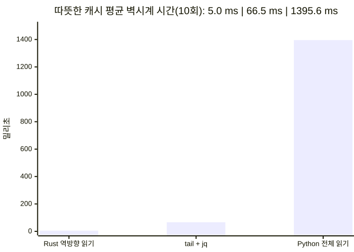

<div align="center">


# jlogtail
[English](README.md)

큰 JSON Lines 대화 기록에서 파일 전체를 메모리에 올리지 않고 끝부분을 읽는 Rust 명령줄 도구이자 Python 모듈입니다.

Rust · Python 3.9+

[](https://pypi.org/project/jlogtail/)
[](https://github.com/elfenomenokim/jlogtail/blob/main/LICENSE)

2.18GB 대화 기록의 끝을 읽는 데 5.0ms입니다. `tail | jq`는 66.5ms, Python으로 전체를 읽으면 1395.6ms입니다. 저장된 10회 측정에서 가져왔습니다.

[설치](#설치) · [시작하기](#시작하기) · [읽는 순서](#읽는-순서)

</div>

<p align="center">
<picture>
  <source media="(prefers-color-scheme: dark)" srcset="https://raw.githubusercontent.com/elfenomenokim/jlogtail/main/docs/demo/dark.gif">
  
</picture>
</p>

[소셜 미리보기 이미지](https://raw.githubusercontent.com/elfenomenokim/jlogtail/main/docs/social.png)

예시 영상에는 가상 대화 행을 사용했습니다. 필드 선택과 필터 동작을 보여 주며, 성능 측정 자료는 아닙니다.

## 설치

```sh
uv tool install jlogtail
# 또는: pipx install jlogtail
```

wheel을 설치하면 `jlogtail` 명령과 가져올 수 있는 PyO3 `jlogtail` 모듈을 함께 사용할 수 있고, Rust는 필요 없습니다. 독립 Rust CLI를 직접 빌드하려면 이 저장소를 받아 그 디렉터리에서 `cargo install --path .`을 실행하세요(crates.io에는 올라가 있지 않습니다). Python 3.9 이상이 필요하고, 소스 빌드에는 Rust 도구 모음도 필요합니다.

## 시작하기

```sh
jlogtail ~/.claude/projects/PROJECT/session.jsonl --lines 20
jlogtail ~/.codex/sessions/SESSION.jsonl --bytes 65536
jlogtail transcript.jsonl --filter payload.role=assistant --fields timestamp,payload.role
jlogtail transcript.jsonl --follow
```

Claude Code, Codex, Pi 대화 기록에 같은 명령을 쓸 수 있습니다. CLI는 기본적으로 원래 JSONL 행을 출력합니다. `--fields`는 선택한 점 경로만 간결한 객체로 출력합니다. `--filter PATH=VALUE`는 JSON 값과 비교하며, JSON 문법이 아닌 값은 문자열로 처리합니다. 바이트 창은 첫 행이 잘린 경우에만 건너뜁니다. 초기 `read_tail`, `--follow` 추가 읽기, 끝나지 않은 마지막 행 버퍼링 모두 `--max-bytes`(기본 64 MiB) 상한을 지킵니다. 상한을 넘는 행은 버퍼를 무한정 키우지 않고 건너뛴 뒤 `stderr`에 알림을 남깁니다. follow를 시작할 때 이미 끝나지 않은 행이 있으면 `--max-bytes` 안에서 첫 바이트부터 보관해, 첫 확인에서 조각이 아니라 완성된 행을 출력합니다.

```console
$ jlogtail docs/demo/agents.jsonl --lines 2 --fields role,text
{"role":"assistant","text":"Checkpoint 42 finished."}
{"role":"assistant","text":"The next run is queued."}
```

## 읽는 순서

<picture>
  <source media="(prefers-color-scheme: dark)" srcset="https://raw.githubusercontent.com/elfenomenokim/jlogtail/main/docs/diagrams/tail-flow.ko.dark.svg">
  
</picture>

## 만든 이유

`tail -n 20 file.jsonl | jq .`는 전체 파일 파이프라인과 복잡한 JSON 질의에 유용하지만, 마지막 행을 찾으려고 파일 처음부터 읽습니다. 이 도구는 뒤에서부터 위치를 찾아 요청한 범위만 읽습니다. 큰 대화 기록이나 반복 조회에 적합합니다.

## 측정값

M5 Pro macOS arm64에서 hyperfine으로 명령마다 예열 3회와 측정 10회를 실행했습니다. 읽기 전용 272.9MB 대화 기록 원본을 8번 반복해 2.18GB 임시 복사본을 만들었습니다. 평균 벽시계 시간은 jlogtail 5.0ms, `tail | jq` 66.5ms, Python 전체 읽기 1395.6ms였습니다. [요약](docs/bench/m5-bench.txt), [원본 출력](docs/bench/m5-hyperfine.txt), [원본 측정 데이터](docs/bench/m5-hyperfine.json)를 확인하세요. 결과는 이 복사본과 호스트에만 적용됩니다.

<picture>
  <source media="(prefers-color-scheme: dark)" srcset="https://raw.githubusercontent.com/elfenomenokim/jlogtail/main/docs/diagrams/bench-results.ko.dark.svg">
  
</picture>

## 옵션

| 옵션 | 설명 |
|---|---|
| `--lines N`, `-n N` | 마지막 N개의 완전한 행을 읽습니다. 기본값은 10입니다. |
| `--bytes N`, `-c N` | 마지막 N바이트를 읽고, 첫 행이 잘렸을 때만 해당 부분을 버립니다. |
| `--from-offset N` | 저장한 바이트 오프셋부터 앞으로 완전한 행을 읽고, 다음 커서와 신원 판정을 `jlogtail: forward: {...}` 형태로 stderr에 출력합니다. |
| `--end N` | 파일이 N바이트 오프셋에서 끝난 것처럼 읽습니다. 마지막 행은 N-1에서 줄바꿈으로 끝나야 하며(아니면 버림), 파일 크기를 넘으면 종료 코드 2입니다. |
| `--follow`, `-f` | 완성된 추가 행을 출력하고, 파일 교체나 잘림 뒤 처음부터 읽습니다. |
| `--filter PATH=VALUE` | 점으로 구분한 경로의 값이 일치하는 행만 남깁니다. |
| `--fields PATH,...` | 선택한 경로만 간결한 객체로 출력합니다. |
| `--poll-ms N` | follow 확인 간격입니다. 기본값은 250ms입니다. |
| `--max-bytes N` | `read_tail`, follow 추가 읽기, 미완성 행 버퍼의 메모리 상한(바이트)입니다. 기본값은 67108864(64 MiB)입니다. |
| `--keep-partial-first` | 바이트 창에서 첫 행의 일부도 유지합니다. |
| `--version`, `-V` | `jlogtail` 버전을 출력하고 종료합니다. |

Python 모듈의 `jlogtail.tail(path, lines=10, byte_window=None, max_bytes=jlogtail.DEFAULT_MAX_BYTES, keep_partial_first=False, errors="strict", raw=False)`는 완성된 원본 행을 반환하며, 상한 초과로 행을 건너뛰거나 창이 잘리면 `RuntimeWarning`을 발생시킵니다. `errors`는 `"strict"`(기본, 잘못된 UTF-8이면 `ValueError`), `"replace"`(잘못된 시퀀스마다 U+FFFD) 또는 `"ignore"`(잘못된 바이트 제거)이며, 행을 먼저 나눈 뒤 디코드하므로 손상된 행이 이웃 행에 영향을 주지 않습니다. `raw=True`이면 각 행이 파일에 저장된 바이트 그대로, 끝의 `\n` 없이 `bytes` 객체로 반환되며 UTF-8 디코드를 거치지 않으므로 잘못된 바이트가 그대로 전달되고 `errors`는 무시됩니다. `jlogtail.tail_window(...)`는 `end_offset`, `max_bytes`, `skipped_oversized`, `ceiling_reached`, `trailing_oversized`가 담긴 메타데이터 사전과 행 목록을 함께 반환합니다. `jlogtail.read_forward(path, offset=0, max_bytes=jlogtail.DEFAULT_MAX_BYTES, errors="strict")`는 저장한 바이트 오프셋부터 앞으로 읽어 `(메타데이터, 행)`을 반환합니다. `meta["new_offset"]`는 저장할 커서이며, 파일이 교체되었거나 오프셋 아래로 줄었거나 읽는 동안 바뀌면 `meta["identity_ok"]`가 거짓이 되고 `rows`는 비어 있어, 호출자가 추측하지 않고 처음부터 다시 읽습니다. 줄바꿈으로 끝나지 않은 마지막 행은 완성될 때까지 보류합니다. `jlogtail.select_native(path)`는 메타데이터 사전과 오래된 순서의 최근 Codex 메시지 객체를 반환합니다. `lib/native-history-tail.py`는 기존 feno-handoff의 단일 경로 인자와 메타데이터 출력을 유지합니다.

## 제한

macOS arm64에서 빌드와 예시를 확인했습니다. Linux와 Windows 빌드는 아직 실행하지 않았습니다. follow는 플랫폼 파일 ID를 비교하고 파일 크기가 줄어든 것을 확인하면 위치를 초기화합니다. 성능 측정은 macOS arm64에서만 했으며, Linux와 Windows의 follow 동작은 실행하지 않았습니다. 필터는 올바른 JSON 행이 필요합니다. follow는 각 행의 줄바꿈이 기록될 때까지 기다립니다. `--max-bytes`(기본 64 MiB)를 넘는 행은 무제한으로 버퍼링하지 않고 건너뛴 뒤 `stderr` 경고(Python에서는 `RuntimeWarning` 및 메타데이터)로 알립니다.

## 기여

이슈와 풀 리퀘스트를 환영합니다. 빌드, 픽스처 확인, 리뷰 방식은 [CONTRIBUTING.md](CONTRIBUTING.md)에 있습니다.

## 라이선스

MIT입니다. [LICENSE](LICENSE)를 보세요.
