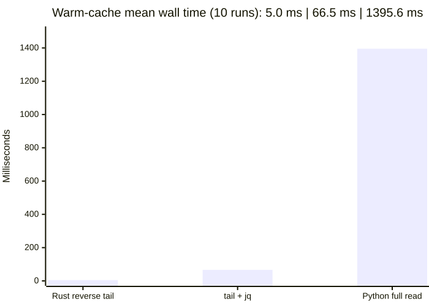

<div align="center">


# jlogtail
[한국어](README.ko.md)

A Rust command-line tool and Python module that read the end of large JSON Lines transcripts without loading the whole file.

Rust · Python 3.9+

[](https://pypi.org/project/jlogtail/)
[](https://github.com/elfenomenokim/jlogtail/blob/main/LICENSE)

5.0 ms for the tail of a 2.18 GB transcript, against 66.5 ms for `tail | jq` and 1395.6 ms for a full Python read, from the saved 10-run file.

[Install](#install) · [Quick start](#quick-start) · [How it reads](#how-it-reads)

</div>

<p align="center">
<picture>
  <source media="(prefers-color-scheme: dark)" srcset="https://raw.githubusercontent.com/elfenomenokim/jlogtail/main/docs/demo/dark.gif">
  
</picture>
</p>

[Social preview](https://raw.githubusercontent.com/elfenomenokim/jlogtail/main/docs/social.png)

The demo uses synthetic transcript rows. It shows field selection and filtering, not benchmark data.

## Install

```sh
uv tool install jlogtail
# or: pipx install jlogtail
```

The wheel installs the `jlogtail` command and the importable `jlogtail` PyO3 module; it needs no Rust. To build the standalone Rust CLI instead, run `cargo install --path .` in a checkout of this repository (it is not on crates.io). Python 3.9+ is required; source builds also require Rust.

## Quick start

```sh
jlogtail ~/.claude/projects/PROJECT/session.jsonl --lines 20
jlogtail ~/.codex/sessions/SESSION.jsonl --bytes 65536
jlogtail transcript.jsonl --filter payload.role=assistant --fields timestamp,payload.role
jlogtail transcript.jsonl --follow
```

Claude Code, Codex, and Pi transcripts use the same JSONL commands. The CLI outputs original rows by default. `--fields` emits a compact object with selected dotted paths. `--filter PATH=VALUE` compares JSON values; unquoted non-JSON values are strings. A byte window skips a partial first record but keeps it when the window starts at a line boundary. Every read path—initial `read_tail`, appended `--follow` reads, and incomplete trailing-record buffering—enforces `--max-bytes` (default 64 MiB). When a record exceeds `--max-bytes`, `jlogtail` skips it and prints a marker to `stderr` instead of growing an unbounded buffer. A row that is already unfinished when follow starts is kept from its first byte when within `--max-bytes`, so the first poll emits the whole row rather than a fragment.

```console
$ jlogtail docs/demo/agents.jsonl --lines 2 --fields role,text
{"role":"assistant","text":"Checkpoint 42 finished."}
{"role":"assistant","text":"The next run is queued."}
```

## How it reads

<picture>
  <source media="(prefers-color-scheme: dark)" srcset="https://raw.githubusercontent.com/elfenomenokim/jlogtail/main/docs/diagrams/tail-flow.en.dark.svg">
  
</picture>

## Why

`tail -n 20 file.jsonl | jq .` is useful for full-file pipelines and richer JSON queries, but it reads from the start to find the last rows. This tool seeks backward to the requested records, then reads only that suffix. It is for large transcripts and repeated polling.

## Measurements

On M5 Pro, macOS arm64, hyperfine ran 3 warmups and 10 measured runs per command against one 2.18 GB temporary copy. The read-only 272.9 MB source transcript was repeated eight times. Mean wall times were 5.0 ms for jlogtail, 66.5 ms for `tail | jq`, and 1395.6 ms for Python's full read. See the [summary](docs/bench/m5-bench.txt), [raw output](docs/bench/m5-hyperfine.txt), and [raw measurements](docs/bench/m5-hyperfine.json). Results describe this copy and host only.

<picture>
  <source media="(prefers-color-scheme: dark)" srcset="https://raw.githubusercontent.com/elfenomenokim/jlogtail/main/docs/diagrams/bench-results.en.dark.svg">
  
</picture>

## Reference

| Option | Meaning |
|---|---|
| `--lines N`, `-n N` | Read the last N complete records; default 10 |
| `--bytes N`, `-c N` | Read N trailing bytes and drop a partial first record unless the window starts at a line boundary |
| `--from-offset N` | Read complete records forward from a saved byte offset; the next cursor and identity verdict are printed to stderr as `jlogtail: forward: {...}` |
| `--end N` | Read as if the file ended at byte offset N; the final row must end with a newline at N-1 (otherwise it is dropped), and N beyond the file size exits 2 |
| `--follow`, `-f` | Emit complete appended records; restart from byte 0 after replacement or truncation |
| `--filter PATH=VALUE` | Keep rows whose dotted key path equals the JSON value |
| `--fields PATH,...` | Emit only the selected dotted paths as a compact object |
| `--poll-ms N` | Follow poll interval; default 250 ms |
| `--max-bytes N` | Memory ceiling in bytes for `read_tail`, follow reads, and pending incomplete records; default 67108864 (64 MiB) |
| `--keep-partial-first` | Keep the first partial row in a byte window |
| `--version`, `-V` | Print the `jlogtail` version and exit |

The Python module provides `jlogtail.tail(path, lines=10, byte_window=None, max_bytes=jlogtail.DEFAULT_MAX_BYTES, keep_partial_first=False, errors="strict")` for raw complete rows (emitting a `RuntimeWarning` if a record is skipped or the window hits `max_bytes`). `errors` is `"strict"` (default: invalid UTF-8 raises `ValueError`), `"replace"` (U+FFFD per invalid sequence) or `"ignore"` (drop invalid bytes); rows are split before decoding, so one damaged row never affects its neighbors. `jlogtail.tail_window(...)` returns `(meta, rows)` with `end_offset`, `max_bytes`, `skipped_oversized`, `ceiling_reached`, and `trailing_oversized`. `jlogtail.read_forward(path, offset=0, max_bytes=jlogtail.DEFAULT_MAX_BYTES, errors="strict")` reads forward from a saved byte offset and returns `(meta, rows)`: `meta["new_offset"]` is the cursor to save, and `meta["identity_ok"]` is false — with `rows` empty — when the file was replaced, shrank below the offset, or changed during the read, so callers rescan instead of guessing. An unterminated trailing row is held until it completes. `jlogtail.select_native(path)` returns a metadata dictionary and oldest-to-newest Codex message objects. `lib/native-history-tail.py` preserves feno-handoff's existing one-path command and metadata output.

## Limits

The benchmark and demo ran on macOS arm64. Linux and Windows builds have not been exercised. Follow compares platform file IDs and resets when it observes a shorter file. The benchmark ran on macOS arm64; Linux and Windows follow behavior has not been exercised. A filter requires valid JSON. A follow poll waits for the newline that completes each row. Records larger than `--max-bytes` (default 64 MiB) are skipped with a clear `stderr` marker (or Python `RuntimeWarning` and metadata count) rather than buffering past the ceiling.

## Contributing

Issues and pull requests are welcome. See [CONTRIBUTING.md](CONTRIBUTING.md) for the build, the fixture check and the review process.

## License

MIT. See [LICENSE](LICENSE).
